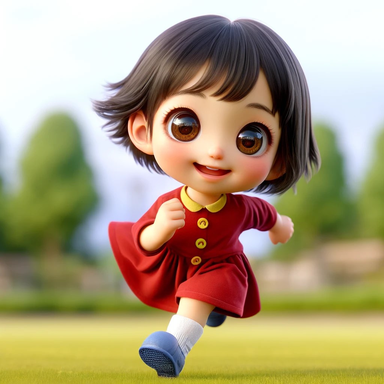
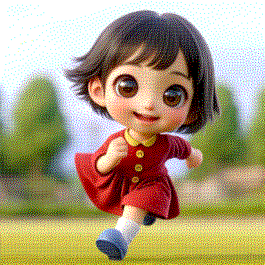
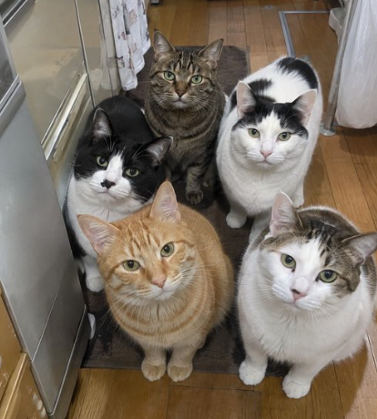
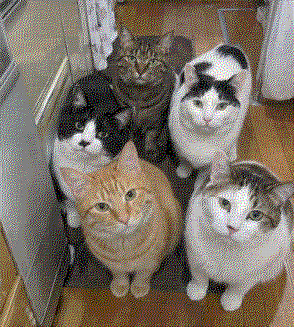
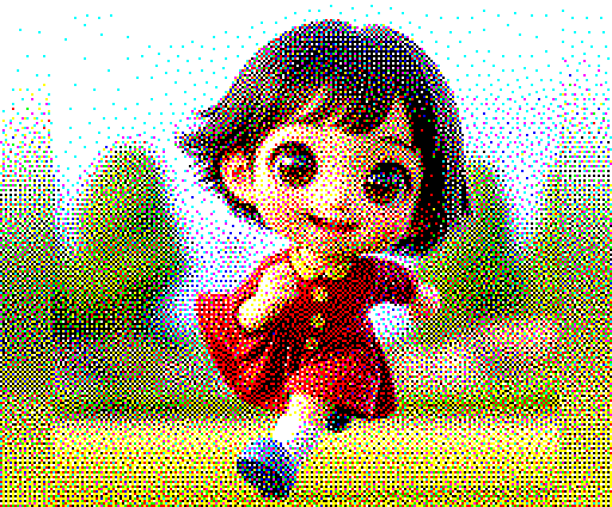

# pic2color4px

## 写真を、たった8色で。

ふつうの写真を、**色が8色しか出せない画面でも「ちゃんと写真に見える」画像**に変えてくれる、無料のツールです。

色が少ない画面で写真を表示すると、ふつうは顔が真っ黒に潰れたり、色がベタッと単調になったりしてしまいます。このツールは、小さなマス目の中の「点の数と並び方」を賢く決めることで、目の錯覚を利用して、たくさんの色があるように見せます。

たとえば、40年以上前のパソコン **MSX2** が出せるのは、基本的に8色。それでも、この通り。

**変換前**



**変換後（使っている色は、たった8色）**



写真でもどうぞ。毛並みのような細かい質感も、ちゃんと残ります。

**変換前**



**変換後（8色）**



こちらは、MSX2 の実際の画面サイズ（横256ドット）で変換したもの。3倍に拡大して表示しています。当時のパソコンの前に座っていた人たちが見たら、きっと驚いたはずです。



## 何がうれしいの？

- **色数の少ない画面で、写真が楽しめます。** カラー電子ペーパー、昔のパソコン、小さな液晶、シールプリンターなど、「出せる色が決まっている」機械は意外とたくさんあります。そういう機械に写真を持っていくための変換ツールです
- **顔が潰れません。** 一番大事な「人の顔、動物の顔がちゃんと見えること」を優先して、点の並び方を決めています
- **速いです。** Rust版なら、写真1枚の変換は1秒前後。待たされません

## 仕組み（ざっくり）

1. 写真を 2×2 ドットの小さなマス目に区切ります
2. マス目ごとに、赤・緑・青の点を「何個点けるか」で色の濃さを決めます（0〜4個で5段階、3色合わせると125通りの「見かけの色」）
3. 点の**並び方**は、近く同士のマス目と助け合うように自動で工夫します。少し離れて見たときに元の色に一番近くなる並び方を選ぶので、なめらかなグラデーションになります

人の目は、細かい点を自然に混ぜて色として感じます。その性質を、計算で最大限に利用しています。

## 使い方

### Rust版（おすすめ、速いです）

```sh
cargo build --release
./target/release/pic2color4px photo.png
# → photo-color4px.png ができます

# 横幅を指定して変換（MSXサイズなどに）
./target/release/pic2color4px photo.png --width 256
```

対応形式：PNG / JPEG 入力、PNG 出力。

### Python版（試作版）

`python/pic2color4px.py` に、同じ考え方のPython実装があります。読み物として、また小さな実験用にどうぞ（処理はRust版よりかなり遅いです）。

## 兄弟ツール

白黒版の [pic2gray4px](https://github.com/tanep3/pic2gray4px) があります。電子ペーパーの小さな画面や、感熱シールプリンター（T02）向けに、写真を「顔がちゃんと見える白黒」に変えるツールです。本ツールは、そのカラー版という位置づけです。

技術的な詳細（アルゴリズム、測定結果、正直な限界）は [docs/TECHNICAL.md](docs/TECHNICAL.md) にまとめました。

## ライセンス

MIT License
